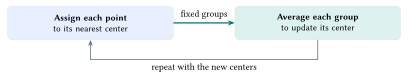
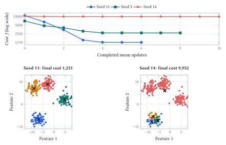
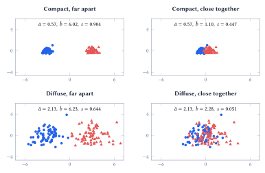

::: {.lecture-note-actions role="navigation" aria-label="Lecture note navigation"}
[Course materials](../lectures/11-kmeans.qmd){.btn .btn-primary .btn-sm}
:::

::: {.callout-note appearance="simple"}
**Learning goals.** Formulate the K-means objective and Lloyd updates; explain why initialization matters; distinguish cohesion, separation, silhouette and ARI; diagnose a clustering through its representation.
:::

## What should count as a group?

News posts can be grouped by topic, style, or repeated wording. The representation determines which differences the algorithm sees.

K-means represents each group by one center. For observations $x_i\in\mathbb{R}^d$ and a chosen number of groups $k$, it minimizes

$$
J(\mu_1,\ldots,\mu_k)=\sum_{i=1}^n\min_{1\leq j\leq k}\|x_i-\mu_j\|_2^2.
$$

 Each point contributes its squared distance to its nearest center. Squaring emphasizes large deviations; changing a feature's units changes its influence.

<figure id="figure-1" class="lecture-11-figure">
<a href="../assets/lecture-notes/lecture-11/lloyd.svg" target="_blank" rel="noopener" aria-label="Enlarge Figure 1"><picture><source media="(max-width: 600px)" srcset="../assets/lecture-notes/lecture-11/lloyd-mobile.svg" width="247.597" height="105.897"></picture></a>
<figcaption>Figure 1. Lloyd’s algorithm alternates two operations, holding the other quantities fixed at each step. <a class="figure-enlarge" href="../assets/lecture-notes/lecture-11/lloyd.svg" target="_blank" rel="noopener" aria-label="Enlarge Figure 1">Enlarge</a></figcaption>
</figure>

For fixed centers, assign $c_i=\operatorname*{arg\,min}_j\|x_i-\mu_j\|^2$. For fixed assignments, replace each nonempty cluster's center by its mean:

$$
\mu_j=\frac{1}{|C_j|}\sum_{i\in C_j}x_i,\qquad C_j=\{i:c_i=j\}.
$$

 Each step decreases or preserves $J$, without guaranteeing the best partition. The notebook leaves an empty cluster's center unchanged.

Broadcast all point-center distances, then average each nonempty group:

    labels = ((X[:, None] - centers)**2).sum(2).argmin(1)
    centers[j] = X[labels == j].mean(axis=0)

## Does the starting point matter?

The same 300 synthetic points and the same $k=4$ can lead to different final partitions. The notebook follows several initializations through their cost trajectories, then checks the clusters each run actually produced.

<figure id="figure-2" class="lecture-11-figure">
<a href="../assets/lecture-notes/lecture-11/starts.svg" target="_blank" rel="noopener" aria-label="Enlarge Figure 2"><picture><source media="(max-width: 600px)" srcset="../assets/lecture-notes/lecture-11/starts-mobile.svg" width="215.012" height="470.960"></picture></a>
<figcaption>Figure 2. Costs decrease but finish at different values. Below are two final partitions; black crosses mark centers. Colors identify groups within each panel. The three seeds were selected to illustrate different outcomes, not their frequency. <a class="figure-enlarge" href="../assets/lecture-notes/lecture-11/starts.svg" target="_blank" rel="noopener" aria-label="Enlarge Figure 2">Enlarge</a></figcaption>
</figure>

A flat trajectory tells us that the updates have stopped improving this solution. It does not tell us whether a different start would find a lower cost. Multiple restarts are a practical safeguard: keep the run with the smallest final objective on the same data and with the same $k$.

**K-means++ chooses more spread-out starting centers.** Choose the first center uniformly from the observations. If $D_i$ is point $i$'s distance to the nearest center already chosen, sample the next center with probability

$$
P(i\text{ is selected})=\frac{D_i^2}{\sum_rD_r^2}.
$$

 Continue until $k$ centers have been selected, then run the usual assignment and mean updates. A point already well represented by a nearby center is less likely to receive another center.

The notebook compares 100 seeds for random starts and the implementation's greedy K-means++ variant, with one Lloyd run per start. A final cost within 1% of the best observed value (1,251.4) occurred in 56 of 100 random starts and 96 of 100 K-means++ starts.

These are dataset-specific frequencies, not a global-optimum guarantee. In `KMeans`, `init` chooses the rule and `n_init` the number of restarts; see the [implementation documentation](https://scikit-learn.org/stable/modules/generated/sklearn.cluster.KMeans.html).

## How good are the clusters?

**Cohesion** asks whether points in the same group are close. **Separation** asks whether other groups are far away. The K-means cost measures within-cluster squared distance; it contains no explicit between-cluster separation term. Increasing $k$ can reduce the best achievable cost simply by adding centers, so cost alone cannot choose $k$.

For point $i$, let $a_i$ be its average distance to the other points in its own cluster. Let $b_i$ be the smallest average distance to the points in any one other cluster. Its silhouette is

$$
s_i=\frac{b_i-a_i}{\max(a_i,b_i)}.
$$

 Mean silhouette averages these pointwise scores. Near $+1$ means strong relative separation; near zero means ambiguity; negative means another group is closer on average. The denominator makes the comparison relative to scale.

<figure id="figure-3" class="lecture-11-figure">
<a href="../assets/lecture-notes/lecture-11/geometry.svg" target="_blank" rel="noopener" aria-label="Enlarge Figure 3"><picture><source media="(max-width: 600px)" srcset="../assets/lecture-notes/lecture-11/geometry-mobile.svg" width="187.399" height="499.689"></picture></a>
<figcaption>Figure 3. Four synthetic examples use the same noise, 70 points per group, and identical axes. Colors show generating groups. Mean distances <em>ā</em> and <em>b̄</em> track cohesion and separation. All four partitions have ARI  = 1 against their generating labels, even when they overlap. <a class="figure-enlarge" href="../assets/lecture-notes/lecture-11/geometry.svg" target="_blank" rel="noopener" aria-label="Enlarge Figure 3">Enlarge</a></figcaption>
</figure>

**ARI asks a different question.** The adjusted Rand index compares a proposed partition with reference labels by checking which pairs belong together or apart, then correcting for chance agreement. Relabeling clusters does not change it. An identical partition has ARI $=1$; chance-level agreement is around zero, and scores can be negative. The reference labels define what counts as agreement, not an unquestionable scientific truth.

For the diffuse, overlapping example, fitting K-means instead of retaining the original groups raises silhouette from 0.051 to 0.344, while ARI against the original labels drops from 1 to 0.033.

Silhouette judges the geometry of a partition; ARI judges its agreement with a supplied reference. Neither replaces inspection of what the groups mean.

## What did we actually group?

The notebook uses posts from four forums in the [20 Newsgroups dataset](https://scikit-learn.org/stable/datasets/real_world.html#the-20-newsgroups-text-dataset): graphics, baseball, medicine and Middle East politics. Forum labels are kept for evaluation; they are not supplied to K-means.

**Represent the documents.** TF-IDF gives each post a vector of word and phrase weights. Terms that are common within a post but less common across the corpus receive more weight. The vectors are normalized to unit length. With this representation, the initial squared distance between two document vectors is $2-2\cos\theta$; fitted centers themselves need not have unit length.

Of 2,339 fetched posts, 2,251 have at least one retained feature; the 88 zero-feature rows are excluded before clustering.

The resulting matrix has 2,000 features. Setting $k=4$ matches the number of selected forums, but does not establish that four is the natural number of groups in the vectors.

**Inspect the features behind a cluster.** One cluster's largest centroid weights include words from a repeated closing signature. All 71 posts in that cluster contain both signature words used in the notebook's check, "shameful" and "surrender."

The loader attempts to remove footers, but that heuristic did not remove this wording. K-means has found a genuine pattern in the supplied representation. The pattern is less useful if the question was about the subjects of the posts.

This is why the notebook pairs cluster composition with the largest centroid weights and actual document excerpts. A score summarizes agreement or geometry; reading the posts explains the mechanism. A two-dimensional projection is another view of the data, not the space in which this text clustering was fitted.

### When the geometry is the wrong model {#when-the-geometry-is-the-wrong-model .unnumbered}

Nearest-center assignments divide Euclidean space into convex Voronoi cells. They work naturally for compact groups, but cannot represent a ring around another group or two interlocking curved groups with one center each. More iterations cannot remove this geometric restriction.

Choosing $k$ therefore combines the cost curve, silhouette, stability across starts, and the purpose of the analysis. The notebook's text example does not produce a single decisive elbow. A small silhouette can reflect overlapping topics, sparse distances, or a representation that emphasizes something else. It is a reason to investigate, not a command to keep adding clusters.

K-means can support exploration, compression and anomaly screening, but distance to a center becomes useful only after the representation and the intended meaning of a group have been checked.

**Acknowledgment.** Prepared for instructor review from the instructor's handwritten notes, supporting lecture transcript, and current notebook, with editorial and typesetting assistance from OpenAI Codex.

**In one sentence:** K-means finds compact groups in the coordinates we provide; initialization, geometric scores and inspection of the actual examples determine how much those groups tell us.
