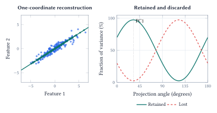
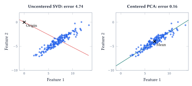
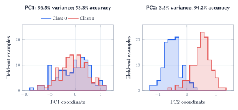
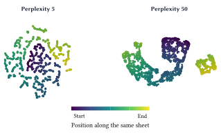
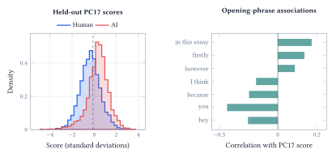

::: {.lecture-note-actions role="navigation" aria-label="Lecture note navigation"}
[Course materials](../lectures/12-pca.qmd){.btn .btn-primary .btn-sm}
:::

::: {.callout-note appearance="simple"}
**Learning goals.** Connect projection variance to reconstruction error; implement centered PCA with SVD; distinguish variance from predictive information; interpret nonlinear maps and real essay patterns cautiously.
:::

## Which information should survive?

Dimensionality reduction replaces many input features with fewer coordinates. Feature selection keeps original columns; feature extraction constructs new ones. What should those new coordinates preserve?

PCA retains variance. For centered observations $x_i$, its first unit direction is

$$
v_1=\operatorname*{arg\,max}_{\|v\|_2=1}\frac1n\sum_i(x_i^\top v)^2.
$$

 The score $z_i=x_i^\top v_1$ is a coordinate; $z_iv_1$ reconstructs the point.

<figure id="figure-1" class="lecture-12-figure">
<a href="../assets/lecture-notes/lecture-12/projection.svg" target="_blank" rel="noopener" aria-label="Enlarge Figure 1"><picture><source media="(max-width: 600px)" srcset="../assets/lecture-notes/lecture-12/projection-mobile.svg" width="208.839" height="355.348"></picture></a>
<figcaption>Figure 1. A synthetic cloud (180 blue points) and one-coordinate reconstructions (teal). The retained and discarded parts are perpendicular, so their squared lengths add: maximizing retained variance minimizes reconstruction error. PC1 retains 97.5%; 2.5% is lost. This criterion knows nothing about a future prediction target. <a class="figure-enlarge" href="../assets/lecture-notes/lecture-12/projection.svg" target="_blank" rel="noopener" aria-label="Enlarge Figure 1">Enlarge</a></figcaption>
</figure>

## Center, decompose, project

Arrange $n$ observations as rows of $X\in\mathbb{R}^{n\times d}$. Subtract the column mean $\mu$ from every row to obtain $X_c$. Centering makes PCA describe variation around the data's mean, rather than distance from the coordinate origin.

<figure id="figure-2" class="lecture-12-figure">
<a href="../assets/lecture-notes/lecture-12/centering.svg" target="_blank" rel="noopener" aria-label="Enlarge Figure 2"><picture><source media="(max-width: 600px)" srcset="../assets/lecture-notes/lecture-12/centering-mobile.svg" width="191.042" height="338.489"></picture></a>
<figcaption>Figure 2. The same cloud is translated by (7, −4). An uncentered rank-one SVD is forced through the origin; centered PCA passes through the mean. Mean squared reconstruction distance is 4.74 without centering and 0.16 with centering. Both panels use the same axes. <a class="figure-enlarge" href="../assets/lecture-notes/lecture-12/centering.svg" target="_blank" rel="noopener" aria-label="Enlarge Figure 2">Enlarge</a></figcaption>
</figure>

The singular value decomposition is

$$
X_c=U\Sigma V^\top.
$$

 The columns of $V$ are the principal directions in feature space. The diagonal singular values $\sigma_1\geq\sigma_2\geq\cdots$ describe their magnitudes. The sample variance along direction $j$ is $\sigma_j^2/(n-1)$: importance depends on the *squared* singular values.

Keep the first $k$ columns in $V_k\in\mathbb{R}^{d\times k}$. Then

$$
Z=X_cV_k\in\mathbb{R}^{n\times k},\qquad
 \widehat X=ZV_k^\top+\mathbf1\mu^\top.
$$

 The notebook implements these expressions directly:

    mean = X.mean(axis=0)
    centered = X - mean
    U, s, Vt = np.linalg.svd(
        centered, full_matrices=False)
    Z = centered @ Vt[:k].T
    reconstruction = Z @ Vt[:k] + mean
    variance_ratio = s**2 / (s**2).sum()

NumPy returns $V^\top$, so its first $k$ rows contain the directions. Reversing the sign of a direction and its scores leaves the reconstruction unchanged. A principal direction has no intrinsically positive end.

## Variance is not the same as useful information

How many components should we keep? Explained variance gives a reconstruction budget:

$$
R_k=\frac{\sum_{j=1}^k\sigma_j^2}{\sum_j\sigma_j^2}.
$$

 In the notebook's actual 384-dimensional essay embeddings, two PCs retain 20.4% of the variance and 30 retain 70.4%. Reaching 90% takes 119 components; reaching 95% takes 178. A two-dimensional PCA view leaves most of the original variation out.

Those percentages do not tell us how well the reduced coordinates predict a label. The following synthetic example makes the distinction visible.

<figure id="figure-3" class="lecture-12-figure">
<a href="../assets/lecture-notes/lecture-12/class-signal.svg" target="_blank" rel="noopener" aria-label="Enlarge Figure 3"><picture><source media="(max-width: 600px)" srcset="../assets/lecture-notes/lecture-12/class-signal-mobile.svg" width="196.086" height="380.139"></picture></a>
<figcaption>Figure 3. The same 240 held-out examples, projected onto two different principal directions. Blue is class 0; coral is class 1. PCA was fitted on 560 training points, and a separate logistic classifier was fitted to each coordinate using training labels. PC1 retains 96.5% of the variance but gives 53.3% held-out accuracy. PC2 retains only 3.5% yet gives 94.2%. Horizontal scales differ because the variances differ. <a class="figure-enlarge" href="../assets/lecture-notes/lecture-12/class-signal.svg" target="_blank" rel="noopener" aria-label="Enlarge Figure 3">Enlarge</a></figcaption>
</figure>

The broad direction mainly contains variation shared by both classes. The narrow direction contains their separation. Discarding low-variance components can therefore discard the signal a supervised model needs. When PCA is part of a predictive pipeline, fit centering, scaling and directions on the training split, then select the number of components using validation performance.

### Units and unusual observations change the question {#units-and-unusual-observations-change-the-question .unnumbered}

PCA measures variance in the units supplied. Expressing one feature in centimeters rather than meters can change which direction dominates. Standardization gives features comparable marginal scales; it is a modeling choice, not an automatic guarantee of a better representation.

Squared distances also give extreme observations substantial influence. The notebook adds only three points to a 180-point cloud and visibly rotates PC1. Before interpreting a direction as an underlying factor, inspect the units, outliers and possible measurement errors that shaped it.

## What does a nonlinear map preserve?

A curved surface may need three ambient coordinates even when it has only two intrinsic degrees of freedom. A linear projection can place distant parts of that surface on top of each other. The notebook contrasts a real mammoth point cloud with a synthetic Swiss roll to make this limitation concrete.

**t-SNE compares neighborhoods.** It constructs high-dimensional pair similarities $p_{ij}$ and low-dimensional similarities $q_{ij}$, then chooses map locations to minimize

$$
\operatorname{KL}(P\|Q)=\sum_{i\ne j}p_{ij}\log\frac{p_{ij}}{q_{ij}}.
$$

 The $p_{ij}$ values describe the original geometry, not class labels or an answer key. Large $p_{ij}$ paired with tiny $q_{ij}$ is expensive: an important original neighbor has been placed far away. The heavy-tailed low-dimensional similarity gives separated points more room. The [original t-SNE paper](https://www.jmlr.org/papers/v9/vandermaaten08a.html) develops this neighborhood-matching objective.

<figure id="figure-4" class="lecture-12-figure">
<a href="../assets/lecture-notes/lecture-12/neighborhoods.svg" target="_blank" rel="noopener" aria-label="Enlarge Figure 4"><picture><source media="(max-width: 600px)" srcset="../assets/lecture-notes/lecture-12/neighborhoods-mobile.svg" width="148.628" height="350.735"></picture></a>
<figcaption>Figure 4. Two computed t-SNE maps of the same 1,400 points sampled from one connected Swiss-roll surface. Only perplexity changes; initialization rule, random seed and iteration budget are held fixed. Color follows position along the sheet. Axes are arbitrary map coordinates, and each panel is scaled independently. <a class="figure-enlarge" href="../assets/lecture-notes/lecture-12/neighborhoods.svg" target="_blank" rel="noopener" aria-label="Enlarge Figure 4">Enlarge</a></figcaption>
</figure>

Perplexity sets an effective neighborhood scale; it is not a hard list of exactly that many neighbors. At a small value, very local relationships can be preserved while larger-scale continuity becomes hard to see. Apparent islands need not be separate populations. Tiny $p_{ij}$ gives a pair less direct weight in the KL sum, but false neighbors still matter through the normalized similarities and repulsive interactions.

UMAP, also compared in the notebook, builds a neighborhood graph. Its `n_neighbors` changes the neighborhood scale, while `min_dist` affects packing in the map. These are related to, but not interchangeable with, t-SNE's perplexity. See the [UMAP parameter guide](https://umap-learn.readthedocs.io/en/latest/parameters.html).

A map is most useful when neighborhood patterns survive reasonable choices of settings and agree with evidence in the original data. Its rotation, island spacing and apparent cluster count are not independent measurements of the world.

## Can a direction explain an AI-text detector?

The notebook studies 14,004 distinct essays with recorded human/AI origin, prompt, model family and text length. The embeddings have 384 coordinates. Coloring the same map by different metadata asks whether an apparent split tracks origin, topic, length, or some mixture of these.

For a more interpretable check, fit PCA on half the essays. Among the first 30 directions, use training labels to select the one most associated with origin after accounting for prompt means. Fit a one-coordinate logistic classifier on that training split. The selection and classifier use labels; PCA itself does not.

<figure id="figure-5" class="lecture-12-figure">
<a href="../assets/lecture-notes/lecture-12/essay-patterns.svg" target="_blank" rel="noopener" aria-label="Enlarge Figure 5"><picture><source media="(max-width: 600px)" srcset="../assets/lecture-notes/lecture-12/essay-patterns-mobile.svg" width="203.208" height="395.327"></picture></a>
<figcaption>Figure 5. Measured results on 7,002 held-out essays. The distributions of the selected PC17 scores overlap substantially. The dashed line is a cutoff learned on the training split. The other panel shows within-prompt correlations between this score and the presence of a phrase in the opening 80 words; these bars are associations, not classifier weights or probabilities. <a class="figure-enlarge" href="../assets/lecture-notes/lecture-12/essay-patterns.svg" target="_blank" rel="noopener" aria-label="Enlarge Figure 5">Enlarge</a></figcaption>
</figure>

PC17 explains only 0.93% of the training embedding variance. The resulting classifier is 67.3% correct on the held-out split, but flags 39.0% of the human essays as AI. That false-positive rate makes the gap between an interesting pattern and a reliable authorship judgment unmistakable.

The positive bar for "in this essay" means that, within these prompts, essays containing that phrase tend to have higher scores on this chosen direction. It does not mean the phrase increases an essay's AI probability by the bar's value, or that using it establishes authorship. The direction's sign was chosen to align with training origin labels.

The final notebook view holds the prompt fixed and recolors the same positions by origin, model family and length. This removes one source of variation while leaving others available for inspection. It does not establish that the pattern transfers to new prompts, writers or generators.

**Acknowledgment.** Prepared for instructor review from the instructor's handwritten notes, supporting lecture transcript, and current notebook, with editorial and typesetting assistance from OpenAI Codex.

**In one sentence:** A reduced representation is useful when we can explain what it preserves, measure what it loses, and resist treating its most visible patterns as conclusions it has not earned.
