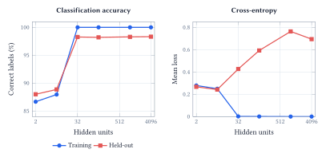
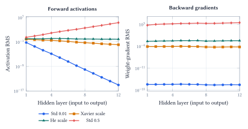
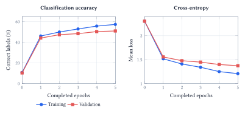

::: {.lecture-note-actions role="navigation" aria-label="Lecture note navigation"}
[Course materials](../lectures/13-nn-architecture.qmd){.btn .btn-primary .btn-sm}
:::

::: {.callout-note appearance="simple"}
**Learning goals.** Explain the role of nonlinear activations; trace a forward pass and a gradient update; diagnose initialization; compare capacity and generalization using both accuracy and cross-entropy.
:::

## Learn coordinates where prediction is easier

A straight boundary struggles with two interlocking moons. Logistic regression reaches 88.0% accuracy on the notebook's 300 synthetic validation points; a nonlinear network reaches 99.7%. Its two final hidden units give us actual learned coordinates to plot, revealing how the representation makes a linear readout useful.

A fully connected layer forms weighted combinations of all inputs:

$$
\begin{aligned}z^{(\ell)}&=W^{(\ell)}h^{(\ell-1)}+b^{(\ell)},\\
h^{(\ell)}&=\phi(z^{(\ell)}),\quad h^{(0)}=x.\end{aligned}
$$

 Each row of $W$ supplies one unit's weights; its bias shifts that unit's threshold. The activation $\phi$ is applied elementwise.

<figure id="figure-1" class="lecture-13-figure">
<a href="../assets/lecture-notes/lecture-13/architecture.svg" target="_blank" rel="noopener" aria-label="Enlarge Figure 1"><picture><source media="(max-width: 600px)" srcset="../assets/lecture-notes/lecture-13/architecture-mobile.svg" width="193.771" height="154.086"></picture></a>
<figcaption>Figure 1. Hidden layers learn features for the final readout. Logits are unrestricted scores; sigmoid or softmax converts them to probabilities. <a class="figure-enlarge" href="../assets/lecture-notes/lecture-13/architecture.svg" target="_blank" rel="noopener" aria-label="Enlarge Figure 1">Enlarge</a></figcaption>
</figure>

Without the nonlinear activation, stacking two affine layers gives

$$
\begin{aligned}W_2(W_1x+b_1)+b_2\\&=(W_2W_1)x+(W_2b_1+b_2).\end{aligned}
$$

 which is still one affine transformation. Extra layers alone do not create the curved boundary.

ReLU, $\phi(z)=\max(0,z)$, passes positive inputs and suppresses negative ones. Combining these units produces piecewise-linear functions with many regions. In PyTorch, `nn.Linear(2, 16)` learns an affine map; adding `nn.ReLU()` prevents the next linear layer from collapsing into it.

## What does more width buy us?

Width increases the number of hidden units and the functions a network can represent. With a suitable activation, sufficiently wide networks can approximate continuous functions on a compact domain. That existence result does not promise easy optimization, good predictions from finite data, or a particular amount of training.

The notebook varies a one-hidden-layer network from 2 to 4,096 ReLU units. Every run uses the same 700 training points, Adam learning rate 0.01, and 10,000 updates, with no dropout or weight decay. Each width is repeated for seeds 0, 1 and 42. A separate sample of 10,000 points from the same noisy-moons generator measures held-out behavior.

<figure id="figure-2" class="lecture-13-figure">
<a href="../assets/lecture-notes/lecture-13/width.svg" target="_blank" rel="noopener" aria-label="Enlarge Figure 2"><picture><source media="(max-width: 600px)" srcset="../assets/lecture-notes/lecture-13/width-mobile.svg" width="206.011" height="377.949"></picture></a>
<figcaption>Figure 2. Means across three initialization seeds after 10,000 updates. Blue is training performance; coral is held-out performance. The width axis is logarithmic. Accuracy and cross-entropy describe different aspects of exactly the same predictions. These are results for this controlled synthetic experiment, not a universal width law. <a class="figure-enlarge" href="../assets/lecture-notes/lecture-13/width.svg" target="_blank" rel="noopener" aria-label="Enlarge Figure 2">Enlarge</a></figcaption>
</figure>

At width 32, the network already classifies every training point correctly. Increasing width to 4,096 raises the parameter count from 129 to 16,385, while held-out accuracy remains near 98.3%. This example does not show the familiar dramatic downturn in classification accuracy as capacity grows.

Cross-entropy tells a less reassuring story. Mean held-out loss is about 0.43 at width 32 and 0.69 at width 4,096, even as training loss approaches zero. A small number of increasingly confident mistakes can worsen loss without changing many predicted labels. The changes are not monotonic at every width.

Accuracy records whether the largest-probability label is correct. Cross-entropy, $-\log p(y\mid x)$, also asks how much probability the model assigned to the correct label. Stable accuracy therefore cannot establish an absence of overfitting or good probability calibration.

The 10,000-point sample is a diagnostic set used in these comparisons. Repeated inspection makes it useful for understanding the experiment, but not an untouched final test for subsequent design choices.

## Follow one example through the network

The notebook's small network has two inputs, two ReLU units and one output logit. Its parameters are

$$
\begin{aligned}W_1&=\begin{bmatrix}.5&-.5\\1&0\end{bmatrix},\quad b_1=\begin{bmatrix}0\\.5\end{bmatrix},\\
W_2&=\begin{bmatrix}1&-1\end{bmatrix},\quad b_2=0.\end{aligned}
$$

 For $x=(1,2)^\top$ and label $y=1$, the forward pass gives

$$
z_1=(-.5,1.5)^\top,\quad h=(0,1.5)^\top,
$$

$$
\begin{aligned}z&=-1.5,\\p&=\operatorname{sigmoid}(z)=0.1824,\\L&=-\log p=1.7014.\end{aligned}
$$

 The first unit is inactive. The second is active, but its negative output weight pushes the prediction away from the true class.

### Backpropagation applies the chain rule {#backpropagation-applies-the-chain-rule .unnumbered}

For binary cross-entropy computed from a logit,

$$
\frac{\partial L}{\partial z}=p-y=-0.8176.
$$

 The gradient through the second hidden unit multiplies this by its output weight $-1$ and its ReLU derivative $1$. Thus $\partial L/\partial z_{1,2}=+0.8176$. For the weight from the first input into this unit, the remaining factor is $x_1=1$:

$$
\frac{\partial L}{\partial W_{1,21}}=0.8176.
$$

 A gradient-descent step with learning rate $0.1$ changes that weight from $1$ to $1-0.1(0.8176)=0.9182$. The inactive first unit has zero incoming gradients for this example. Updating *all* parameters raises the predicted probability to about 0.309 and reduces the loss to 1.1738; that improvement should not be attributed to changing this one weight alone.

### The three training operations do different jobs {#the-three-training-operations-do-different-jobs .unnumbered}

    logits = model(inputs)
    loss = criterion(logits, targets)
    optimizer.zero_grad()
    loss.backward()
    optimizer.step()

The forward pass builds predictions and a loss. `zero_grad()` clears stored gradients, not weights. `backward()` accumulates derivatives in the parameters' `.grad` fields; it does not update them. `step()` applies the optimizer's update. A logits-based loss handles the sigmoid or softmax calculation stably, so an extra probability activation should not be inserted before it.

For the selected weight, the notebook also compares backpropagation with the central difference $[L(w+\varepsilon)-L(w-\varepsilon)]/(2\varepsilon)$. In double precision they agree to about $4\times10^{-12}$. This checks a local derivative away from a ReLU corner; it does not verify every aspect of training.

## Can the signal survive the journey?

Backpropagation multiplies local derivatives. Sigmoid and $\tanh$ have small derivatives in their saturated regions. ReLU's derivative is one on its positive side and zero on its negative side, but intervening weights can still shrink or amplify the gradient. Forward activations can suffer the same problem.

The notebook isolates this effect using 12 hidden ReLU layers of width 64, 512 random inputs and random targets. Every initialization uses the same underlying random weight patterns and readout; only the hidden weight scale changes. No training is performed in this diagnostic.

<figure id="figure-3" class="lecture-13-figure">
<a href="../assets/lecture-notes/lecture-13/initialization.svg" target="_blank" rel="noopener" aria-label="Enlarge Figure 3"><picture><source media="(max-width: 600px)" srcset="../assets/lecture-notes/lecture-13/initialization-mobile.svg" width="212.835" height="400.522"></picture></a>
<figcaption>Figure 3. Root-mean-square activations and weight gradients through the same untrained network. Both vertical axes are logarithmic. Very small weights nearly erase the signal, while large weights amplify it. He scaling keeps the magnitudes more stable in this ReLU example. Zero initialization is omitted from the log plots because all hidden activations and weight gradients are zero. <a class="figure-enlarge" href="../assets/lecture-notes/lecture-13/initialization.svg" target="_blank" rel="noopener" aria-label="Enlarge Figure 3">Enlarge</a></figcaption>
</figure>

For a layer with $\text{fan\_in}$ inputs, the tested Xavier-scale standard deviation is $1/\sqrt{\text{fan\_in}}$. The He-scale value is $\sqrt{2/\text{fan\_in}}$, which compensates approximately for the variance lost when ReLU suppresses negative inputs. Here those values are $0.125$ and about $0.177$.

These rules rely on assumptions about the inputs, weights and activations. They provide a useful starting scale, not a guarantee for every architecture. Normalization, residual connections, activation choices and the optimizer can also affect signal propagation, but the experiment holds those possibilities aside to expose the initialization effect.

**Why not start every weight at zero?** Identically initialized hidden units receive identical signals and cannot develop distinct roles through identical updates. In this particular zero-bias ReLU network, all hidden activations and hidden weight gradients are exactly zero. The output bias can still change; that does not give the hidden layers a useful representation.

A practical diagnostic is to inspect activation and gradient magnitudes across layers. A model can have enough parameters to represent the task while having almost no usable gradient with which to learn it.

## From two inputs to 3,072 pixels

Each [CIFAR-10](https://www.cs.toronto.edu/~kriz/cifar.html) image contains $32\times32$ RGB pixels. Flattening produces 3,072 inputs. The notebook trains the MLP

$$
3072\longrightarrow512\longrightarrow256\longrightarrow128\longrightarrow10
$$

 with ReLU hidden activations and dropout. A layer from $d$ inputs to $h$ outputs has $dh+h$ parameters. The full network has 1,738,890; about 90.5% belong to the first layer.

The experiment uses 45,000 training images, 5,000 validation images and a separate 10,000-image test set. After each of five training epochs, both training and validation performance are measured in evaluation mode. That makes the curves comparable by disabling dropout for both measurements.

<figure id="figure-4" class="lecture-13-figure">
<a href="../assets/lecture-notes/lecture-13/cifar.svg" target="_blank" rel="noopener" aria-label="Enlarge Figure 4"><picture><source media="(max-width: 600px)" srcset="../assets/lecture-notes/lecture-13/cifar-mobile.svg" width="200.981" height="362.790"></picture></a>
<figcaption>Figure 4. Measured learning curves from the notebook’s saved CIFAR-10 run. Epoch zero is before training. Training accuracy reaches 57.4% and validation accuracy 51.1%; both losses are still decreasing. Blue is training and coral is validation. <a class="figure-enlarge" href="../assets/lecture-notes/lecture-13/cifar.svg" target="_blank" rel="noopener" aria-label="Enlarge Figure 4">Enlarge</a></figcaption>
</figure>

There is a generalization gap, but validation performance is still improving. These five epochs do not show a validation-loss turnaround. The final held-out test accuracy is 52.0% with cross-entropy 1.375. Class performance varies: ship accuracy is 73.8%, while bird accuracy is 30.9%.

The notebook shows a dog classified as a ship with 99.9% confidence, and a correctly classified ship with only 13.7% confidence. These examples expose failure modes; assessing calibration requires many predictions, not one striking mistake.

A dense network can learn from pixels, but it has no explicit bias toward local spatial structure or shared detectors across positions. This limitation motivates convolutional architectures.

**Acknowledgment.** Prepared for instructor review from the instructor's handwritten notes, supporting lecture transcript, and current notebook, with editorial and typesetting assistance from OpenAI Codex.

**In one sentence:** Nonlinearity makes learned representations expressive, gradients make them trainable, and careful held-out evaluation tells us which parts of that learning transfer beyond the training examples.
